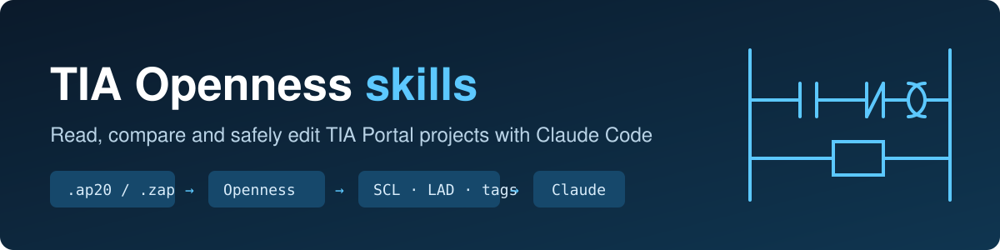
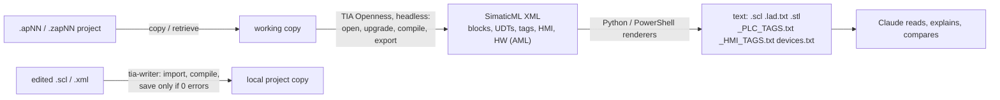

# TIA Openness skills for Claude Code



[](https://github.com/abdullah-zmoosa/tia-openness-skills/actions/workflows/ci.yml)
[](LICENSE)

Let [Claude Code](https://claude.com/claude-code) **read, review, compare and (on request) edit
Siemens TIA Portal projects**: every OB/FB/FC/DB, UDTs, PLC tags with I/O addresses, HMI screens
and tags, hardware configuration and IP addresses.

Two skills, packaged as a Claude Code plugin:

| Skill | What it does | Changes your project? |
|---|---|---|
| **tia-reader** | Exports a `.ap17`–`.ap20` project or `.zap` archive to readable text (SCL, LAD/FBD/STL as text, tag lists, HMI tag maps, device/IP list) and compares two exports | **Never.** Works on a copy |
| **tia-writer** | Imports edited SCL / LAD XML / DB / UDT / tag tables into a **local copy**, compiles, and saves only if clean. Optional check-out / publish to a shared drive | Only on explicit request, and only the local copy |

Ask Claude things like:

> "Read `D:\Projects\Line1\Line1_V105` and explain the start/stop logic."
>
> "Which inputs does FC_Hopper use? Give me the addresses."
>
> "Compare `Line1_V104.zap20` with the current project, everything except comments."
>
> "Change the upper limit in FC_Tension network 3 to 50, dry run first."

---

## How it works



- Uses **Siemens TIA Portal Openness** (the official TIA automation API), driven from Windows
  PowerShell 5.1 with small C# helpers compiled at runtime. No extra binaries ship with this repo.
- The original project is never opened: the reader copies it first, and older projects are
  upgraded **in the copy** only.
- Projects are compiled in the copy before export, because upgraded or uncompiled projects are
  "inconsistent", and Openness refuses to export inconsistent blocks.

## Requirements

| Need | Notes |
|---|---|
| Windows + TIA Portal **V20** with **Openness** | Openness is an option in the TIA installer. Reads V17–V20 projects. |
| Your Windows user in the local group **`Siemens TIA Openness`** | An admin adds it: `net localgroup "Siemens TIA Openness" <DOMAIN>\<user> /add`, then **sign out/in** |
| Python 3 | Not the Microsoft Store stub |
| Claude Code | |

The first Openness call on a PC may show a TIA "allow access" dialog. Click **Yes**.

Run the environment check:

```powershell
powershell -ExecutionPolicy Bypass -File scripts\doctor.ps1
```

## Install

**As a plugin (recommended).** In Claude Code:

```
/plugin marketplace add abdullah-zmoosa/tia-openness-skills
/plugin install tia-openness@tia-openness-skills
```

From a local clone instead: `/plugin marketplace add C:\path\to\tia-openness-skills`.

**Or as plain skills.** Copy `skills\tia-reader` and `skills\tia-writer` into
`%USERPROFILE%\.claude\skills\` and restart Claude Code.

Both skills then load automatically when you mention a TIA project.

## What you get from an export

`%USERPROFILE%\TIA_Exports\<project>_<timestamp>\export\`

| Path | Contents |
|---|---|
| `blocks/*.lad.txt` | LAD/FBD networks as text (block calls with parameter bindings, coils, contacts) |
| `blocks/*.scl`, `*.stl` | SCL / STL source |
| `blocks/*.xml` | full SimaticML per block (DB members, start values, interfaces) |
| `manifest.json` | block inventory: type, language, know-how protection, safety |
| `udt/` | user and system data types |
| `tags/_PLC_TAGS.txt` | every PLC tag: name, address, type, table, comment |
| `hmi/<HMI>/_HMI_TAGS.txt` | HMI tag → PLC tag / connection |
| `hmi/<HMI>/ScreenFolder/**` | screens (XML + flattened text) |
| `hw/devices.txt`, `hw/project.aml` | devices, modules, firmware, IP / PROFINET names, I/O ranges; AutomationML |
| `to/*.params.txt` | technology objects (PID, counters, axes) |
| `../export.log` | compile result and anything skipped |

Compare two exports (noise such as timestamps and GUIDs is removed):

```
python skills\tia-reader\tools\compare_exports.py <exportA> <exportB>
```

## The writer's safety rails

- Writes **only** into the local work area (`C:\TIA_Work` by default). Shared paths are refused.
  `tia_checkout.ps1` copies a project in, and `tia_publish.ps1` copies it back **only when you ask**.
  Publishing refuses if the shared copy changed since checkout, and zips it first.
- Backup zip of the project before every write.
- Saves **only** if every import succeeds **and** the compile has 0 errors. Otherwise it closes without saving.
- Refuses safety (F-) blocks, know-how-protected blocks, non-V20 projects, and folders named in
  `TIA_PROTECTED_SEGMENTS` (default `Master;Archive`).
- **Never downloads to a PLC.** You review the change in TIA and download it yourself.

## Configuration (environment variables, all optional)

| Variable | Default | Purpose |
|---|---|---|
| `TIA_OPENNESS_DLL` | from registry | path to V20 `Siemens.Engineering.dll` |
| `TIA_EXPORT_ROOT` | `%USERPROFILE%\TIA_Exports` | exports, logs, backups |
| `TIA_WORK_ROOT` | `C:\TIA_Work` | local work area for writes |
| `TIA_PYTHON` | auto | Python 3 executable |
| `TIA_REQUIRE_SEGMENT` | *(none)* | e.g. `Working`: writer and checkout only accept paths containing `\Working\` |
| `TIA_PROTECTED_SEGMENTS` | `Master;Archive` | folder names that are never written to or published into |
| `TIA_MIRROR_ANCHOR` | *(none)* | checkout mirrors the path below this folder name instead of below the drive root |

## Limitations

- V21+ projects are not supported yet (V20 Openness). The writer needs `.ap20`.
- WinCC **Unified** HMIs are detected but not exported. Classic Comfort/Advanced HMIs are exported.
- Multi-PLC projects: only the first PLC's blocks and tags are exported (HMI and hardware cover all devices).
- LAD rendering is textual. Calls, parameter bindings and coils are exact; complex series/parallel
  contact topology is approximated.
- Know-how-protected blocks export their interface only.
- A project that doesn't compile can't have its broken blocks exported.
- Without TIA Portal + Openness nothing can be exported, because the project format is not public.
  The renderers and the compare tool do work on existing exports on any machine with Python.

## Troubleshooting

| Message | Fix |
|---|---|
| `not member of the windows group 'Siemens TIA Openness'` | Add the user, then sign out/in. Without signing out: `tia_pending.ps1` queues the job and prints a one-line `runas` command. |
| `Inconsistent blocks ... cannot be exported` | Compile errors in the project. Fix them in TIA. |
| `The device is not supported` (HMI) | Old HMI device version under V20. Use Change device/version in TIA. |
| Writer `Refused: ...` | A safety rail fired. The message says which one. |

## Disclaimer

Not affiliated with, endorsed by, or supported by Siemens AG. SIMATIC, STEP 7, WinCC, TIA Portal
and TIA Portal Openness are trademarks of Siemens AG. You need your own licensed TIA Portal
installation. This software can modify engineering projects. Use it on copies, review every change in
TIA Portal, and follow your site's change-management and safety procedures. Provided "as is", without
warranty (see [LICENSE](LICENSE)).

## Repository layout

```
.claude-plugin/     plugin + marketplace manifests (Claude Code)
.github/workflows/  CI: offline tests on windows-latest (no TIA needed)
docs/               architecture and Openness notes
img/                README artwork
scripts/            doctor.ps1 - environment check
skills/tia-reader/  read-only export + renderers + compare
skills/tia-writer/  local-copy writer, checkout, publish
tests/              synthetic SimaticML fixtures, Python + PowerShell tests
plugin.json         plugin manifest (root copy)
```

## Development

```powershell
python -m unittest discover -s tests -v                                    # renderers, compare (no TIA)
powershell -ExecutionPolicy Bypass -File tests\test_static.ps1             # parse, ASCII, writer guards (no TIA)
powershell -ExecutionPolicy Bypass -File scripts\doctor.ps1                # needs TIA V20 + Openness
```

See [docs/architecture.md](docs/architecture.md) for how the pipeline works.

## Contributing

Issues and pull requests are welcome. See [CONTRIBUTING.md](CONTRIBUTING.md) and [SECURITY.md](SECURITY.md).
